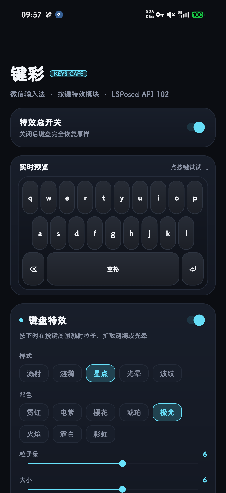

# 键彩 · Keys Cafe for 微信输入法

给手机版**微信输入法**做的按键特效 LSPosed 模块，对标三星输入法的 Keys Cafe：
按下按键时，键帽会缩放弹跳、键内被着色、键周溅出粒子或扩散涟漪。



<p>
  
  
  
  
</p>

> 只在微信输入法 **4.0.1**（`com.tencent.wetype`）上验证过。其它版本理论上也能挂上，
> 因为类查找全部基于方法签名而非混淆名，但没实测。详见[已知限制](#已知限制)。

---

## 三类效果

| 类别 | 说明 | 可选样式 |
|---|---|---|
| **Keyboard Color**<br>键周特效 | 按键周围的粒子、波纹、光晕 | 溅射、涟漪、星点、光晕、波纹 |
| **Key Color**<br>按键配色 | 按键内部的颜色与图案 | 纯色、渐变、流光、斜纹、点阵、霓虹、彩虹 |
| **Key Motion**<br>按键动效 | 按键自身的缩放与形变 | 收缩、放大、弹跳、果冻、下沉 |

三类效果可以任意组合，各自独立开关。全部关闭时键盘与原版完全一致，
模块连 `invalidate()` 都不会调，等于不存在。

### Keyboard Color（键周特效）

| 样式 | 表现 |
|---|---|
| 溅射 | 从**触点**位置向四周喷出 10~24 个粒子（圆点/碎片/星芒三种形状），受重力下坠 |
| 涟漪 | 2~3 圈圆环从按键中心向外扩散，彼此错开 70ms |
| 星点 | 按键范围内随机位置接连闪出小星星 |
| 光晕 | 一团径向渐变的柔光从中心扩散 |
| 波纹 | 从触点开始把整个键「灌满」的实心渐变 |

粒子从触点而非中心出发是有意为之：按边缘和按中心的手感应该不一样。
同一个键的配色是固定的（每个键一个随机种子），不同键之间有差异，
这样看起来像「这个键自己的颜色」，而不是每帧乱闪。

### Key Color（按键配色）

七种图案全部裁剪在键帽圆角之内，因此不会溢出键帽边缘。

### Key Motion（按键动效）

| 样式 | 按下 | 松手 |
|---|---|---|
| 收缩 | 匀速缩小 | 回弹到原尺寸 |
| 放大 | 略微放大 | 缩回 |
| 弹跳 | 缩小 | `easeOutBack` 过冲回弹（默认） |
| 果冻 | 横向变宽 + 纵向变扁 | 阻尼正弦振荡 |
| 下沉 | 轻微缩小 + 整体下移 | 上浮复原 |

---

## 安装

### 前置条件

- 已 root，并装好 **LSPosed**（Zygisk 或 Riru 均可）
- 手机上是**微信输入法**，且已设为当前输入法
- 电脑上有 `adb`

### 步骤

**1. 装 APK**

从 [Releases](../../releases) 下载 `KeysCafe.apk` 直接安装，
或者把仓库拉下来自己编译（见[构建](#构建)）后执行：

```bash
bash install.sh
```

**2. 授权（必须做，否则改设置不生效）**

```bash
adb shell su -c "pm grant com.keyscafe.wetype android.permission.WRITE_SECURE_SETTINGS"
```

> 为什么要这一步：模块 App 和微信输入法是**两个进程**，配置要跨进程传。
> Android 11+ 的包可见性和 SELinux 的 per-app 隔离把常规共享手段全堵死了，
> 最后只能用 `Settings.Global` 当通道，而写系统设置需要这个签名级权限。
> `install.sh` 已经带了这一步，手动装 APK 的话必须自己补。

**3. 在 LSPosed 里启用**

- LSPosed → 模块 → 勾选「键彩」
- 点进「键彩」→ 作用域 → 勾选「微信输入法」（`com.tencent.wetype`）
- 强制停止微信输入法一次（或在 LSPosed 里点「重启应用」）

**4. 打字试试**

打开任意输入框，按住一个键不放，应该能看到键帽缩小、键内变色、周围冒出粒子。

---

## 使用

打开「键彩」App，页面从上到下是：总开关 → 实时预览 → 三类效果 → 启用说明。

预览里的迷你键盘**跑的是和真机完全相同的特效代码**，所以可以在这里调好参数再去打字。

**改完立即生效，不用重启输入法。** 原理：输入法进程在每一帧绘制和每次触摸时都会重读配置，
节流 700ms，所以最慢 0.7 秒后新样式就会出现在键盘上。

### 参数说明

| 参数 | 范围 | 作用 |
|---|---|---|
| 粒子量 | 1~10 | 每次按下生成的粒子个数（4 + 2×值） |
| 大小 | 1~10 | 粒子/波纹的尺寸 |
| 扩散速度 | 1~10 | 粒子的初速与存活时长 |
| 特效限制在按键范围内 | 开/关 | 关掉后波纹会溢出键帽，扩散到相邻按键上 |
| 不透明度 | 0~100 | 键内配色的强度 |
| 只在按下时着色 | 开/关 | 关掉后所有键常亮着色 |
| 幅度 / 时长 | 1~10 | 动效的形变量与动画时长 |

### 命令行改配置

配置就是 `Settings.Global` 里的一个 JSON 字符串，可以直接改：

```bash
# 看当前配置
adb shell su -c "settings get global keyscafe_fx_config"

# 换样式：kcStyle 0溅射 1涟漪 2星点 3光晕 4波纹
adb shell su -c 'settings put global keyscafe_fx_config "{\"master\":true,\"kcOn\":true,\"kcStyle\":1,...}"'
```

字段含义见 [`FxConfig.java`](src/com/keyscafe/wetype/FxConfig.java)（注意 JSON 里 `debug` 的键名是 `dbg`）。

---

## 原理

一句话：**微信输入法的键盘是整块自绘的，不是「一个按键一个 View」**，
所以三类效果全部挂在绘制层，按键的按下/抬起靠拦截触摸事件 + 矩形命中测试来判断。

```
键盘 View.draw(Canvas)
  ├─ onDraw → 遍历按键 → ButtonDrawer.b(button)      ← 钩这里
  │     ├─ canvas.save()
  │     ├─ canvas.scale(sx, sy, cx, cy)   ← Key Motion
  │     ├─ 原按键绘制（背景/文字/图标）
  │     ├─ 键内配色叠加（Key Color）        ← proceed() 之后
  │     └─ canvas.restore()
  └─ 粒子/波纹叠加层                        ← 键盘 draw 之后
```

细节（类结构、混淆踩坑、配置通道的四种失败方案、性能取舍）见
**[docs/ARCHITECTURE.md](docs/ARCHITECTURE.md)**。

---

## 构建

不依赖 Gradle，只用 5 个命令行工具：`aapt2` → `javac` → `d8` → `zipalign` → `apksigner`。

### 环境

- JDK 17+
- Android SDK：`platforms;android-34` + `build-tools;34.0.0`
- libxposed API 102 的 `classes.jar` → 见 [libs/README.md](libs/README.md)
- `zip`

### 命令

```bash
bash build.sh        # 产出 KeysCafe.apk
bash install.sh      # 安装 + 授权 + 重启输入法
```

若工具不在默认位置，用环境变量指定：

```bash
JAVA_HOME=/path/to/jdk \
ANDROID_HOME=/path/to/sdk \
API_JAR=/path/to/classes.jar \
bash build.sh
```

`build.sh` 会自动挑 build-tools 里版本号最大的那一份，也会自动生成一个
调试用密钥库（口令 `android`）。**正式分发请换成自己的密钥库**，否则升级时会签名冲突。

---

## 调试

```bash
adb logcat -s KeysCafe
```

正常情况下第一条应该是：

```
hooked kb=com.tencent.wetype.plugin.hld.keyboard.selfdraw.o
        drawer=...selfdraw.e key=...selfdraw.j drawKey=b rects=F/t
```

| 日志 | 含义 |
|---|---|
| `hooked kb=...` | 钩子挂上了 |
| `drawerType getter = u (xxx)` | 反查到了 drawerType 读取方法 |
| `drawRect getter = t sum0=... sum1=...` | 矩形采样完成，已选定绘制区 |
| `press@(x,y) F=Rect(...) t=Rect(...)` | 首次按下的实际矩形，排查偏移用 |
| `config unreachable, using defaults` | 读不到配置，检查授权 |
| 完全没有 `hooked` | 模块没被注入：检查 LSPosed 启用、作用域、是否重启过输入法 |

### 描边调试

配置里把 `dbg` 设为 `true`，每个按键会画出两个框：

- **绿色** = 按键层看到的矩形（钩 `drawKey` 时取的）
- **红色** = 特效层看到的矩形（键盘 `draw` 之后取的）

两者严丝合缝，说明两层坐标系一致，特效不会偏。截图验证过：

```
Q bbox (13,1690,139,1887) size (126,197)
```

---

## 已知限制

- **只验证了微信输入法 4.0.1**。类查找已尽量抗混淆（全靠签名），但大版本升级后
  `pickDrawKeyMethod` 的启发式仍可能失效，那时需要重新反编译确认结构。
- **动效只缩放按键自身**，键帽缩小后露出来的是键盘底色。这与 Keys Cafe 的行为一致，
  但如果你想要「按键下面还有一层底色」，需要另外画，目前没做。
- **长按弹出的放大预览不跟随缩放**，那一层由输入法自己绘制，不在钩子范围内。
- **配置通道依赖签名级权限**。不执行 `pm grant` 的话，模块会用默认配置跑，
  在设置页改动无法传到输入法进程（设置页会弹一次提示）。
- 手势输入、滑行输入的特效以「手指当前所在键」为准，不会画出整条滑动轨迹。

---

## 常见问题

**Q：装了模块、也启用了，但键盘没变化。**
先看 `adb logcat -s KeysCafe` 有没有 `hooked`。没有的话是作用域没勾对，
或者没重启输入法进程（输入法常驻，改完模块必须强制停止一次）。

**Q：设置页改了没反应，还弹了个 Toast。**
Toast 里那句话就是原因——没授权 `WRITE_SECURE_SETTINGS`。执行：

```bash
adb shell su -c "pm grant com.keyscafe.wetype android.permission.WRITE_SECURE_SETTINGS"
```

**Q：特效位置偏了 / 画到了按键外面。**
开 `dbg` 描边对比绿框和键帽。如果绿框本身就偏，说明矩形选错了（两个候选选反了），
把 `adb logcat` 里的 `drawRect getter` 那行发出来。

**Q：打字变卡了。**
先关掉「粒子量」到 3 以下，或者直接关掉键盘特效只留动效。
动效是纯 canvas 变换，几乎零成本；粒子才是主要开销（上限 160 个）。

**Q：能用在搜狗/百度输入法上吗？**
不能直接改个包名就用。这三个模块文件（`Module.java`）里的类名、方法判据都是针对
微信输入法的自绘结构写的，别的输入法结构完全不同，需要重新分析。

---

## 目录结构

```
keyscafe/
├── src/com/keyscafe/wetype/
│   ├── Module.java          Xposed 入口：类发现、三个钩子、命中测试、帧循环、配置读取
│   ├── Fx.java              特效引擎（纯 android.graphics，预览与真机共用）
│   ├── FxConfig.java        配置项 + JSON 序列化 + 越界钳制
│   ├── Palette.java         8 套主题色 + 9 个基色
│   ├── SettingsActivity.java 设置界面（纯代码构建，无 XML 布局）
│   ├── PreviewView.java     设置页里的迷你键盘预览
│   ├── FlowLayout.java      芯片自动换行布局
│   ├── Ui.java              界面工具（dp/sp、圆角、卡片、芯片）
│   ├── Store.java           配置存取 + 发布到 Settings.Global
│   ├── GlobalKeys.java      跨进程通道的键名
│   └── ConfigProvider.java  配置出口（退路，当前未生效）
├── meta/                    META-INF/xposed/ 的三个文件
│   ├── module.prop          minApiVersion=102 / targetApiVersion=102 / staticScope=true
│   ├── java_init.list       入口类名
│   └── scope.list           作用域：com.tencent.wetype
├── res/                     图标与字符串
├── docs/
│   ├── ARCHITECTURE.md      技术细节
│   └── screenshot.png
├── AndroidManifest.xml
├── build.sh                 构建
└── install.sh               安装
```

---

## 免责声明

本项目是个人学习逆向与 Xposed 开发的产物，与腾讯公司无关，未使用其任何代码或资源。

- 只在**自己拥有**的设备上使用；
- 修改第三方应用运行时行为可能违反其用户协议，风险自负；
- 模块不收集、不上传任何数据，所有配置只存在本机 `Settings.Global` 里；
- 因使用本模块导致的任何问题（包括但不限于应用异常、账号风险），作者不承担责任。

## 许可证

[**Unlicense**](LICENSE) —— 本项目已进入**公共领域**（Public Domain）。

这是软件领域最宽泛的授权形式：作者放弃全部著作权利益，不保留任何条件。你可以：

- **商用**，包括打包进自己售卖的产品；
- **闭源**衍生，修改后不必公开源码；
- **不署名**，去掉原作者信息、改名、以自己的名义重新发布；
- **不做任何声明**，不必保留本 LICENSE 文件，也不必告知作者。

没有「保留版权声明」的要求，没有「相同方式共享」的传染性，也不需要征得同意。

唯一保留的是**无担保**条款：软件按原样提供，不附带任何明示或暗示的保证；使用后出现任何问题（包括设备异常、应用崩溃、账号风险），作者不承担责任。

> 之所以用 Unlicense 而不是 CC0：CC0 是为内容作品（文本、图像、数据）设计的，其中关于专利与商标的条款在软件场景下表述不清，自由软件基金会（FSF）也不建议将其用于代码。Unlicense 是专为软件写的公共领域奉献文本，语义更贴合，GitHub 也能正确识别。
